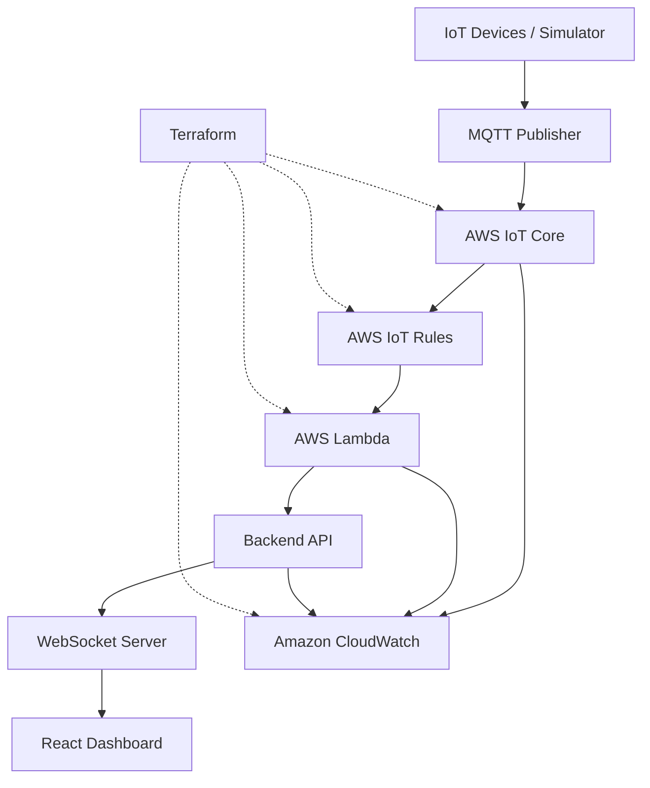

# AWS IoT Realtime Data Pipeline

A cloud-native, event-driven IoT data pipeline built with MQTT, AWS infrastructure, Terraform, and a real-time monitoring dashboard.

## Overview

AWS IoT Realtime Data Pipeline is a project designed to collect, process, and visualize IoT device telemetry in real time using cloud infrastructure.

The project demonstrates how MQTT-based IoT communication can be integrated with AWS services to build an event-driven and scalable data pipeline.

IoT devices publish telemetry messages through MQTT. Incoming messages are routed through the cloud infrastructure, processed by backend services, and delivered to a real-time dashboard for monitoring and visualization.

Infrastructure provisioning is managed using Terraform to support consistent and repeatable deployments.

The project follows a monorepo architecture, separating frontend applications, backend services, and infrastructure configuration.

## Architecture

The intended production architecture uses AWS-managed services for IoT connectivity, event processing, and monitoring.



> **Note:** This represents the intended AWS architecture. Actual deployed components depend on the Terraform configuration and implemented service integrations.

### Data Flow

1. IoT devices or a simulator generate telemetry data.
2. The MQTT publisher sends messages to designated MQTT topics.
3. AWS IoT Core receives and manages incoming MQTT messages.
4. AWS IoT Rules route matching messages to downstream services.
5. AWS Lambda processes and transforms telemetry events.
6. The backend API handles application-level communication.
7. WebSocket distributes real-time updates to connected clients.
8. The React dashboard displays incoming IoT data.

## Technology Stack

| Technology | Purpose |
|---|---|
| AWS IoT Core | Managed MQTT messaging |
| AWS Lambda | Serverless event processing |
| AWS IoT Rules | Event routing |
| Amazon CloudWatch | Logging and monitoring |
| Terraform | Infrastructure as Code |
| Node.js | Backend runtime |
| TypeScript | Application development |
| Express.js | REST API |
| WebSocket | Real-time communication |
| React | Monitoring dashboard |
| Vite | Frontend development |
| MQTT | IoT communication protocol |
| Eclipse Mosquitto | Local MQTT testing |

## Project Structure

```text
mqtt-iot-pipeline/
│
├── apps/
│   └── dashboard/
│       ├── src/
│       ├── public/
│       └── package.json
│
├── services/
│   ├── api-server/
│   │   ├── src/
│   │   └── package.json
│   │
│   └── publisher/
│       ├── src/
│       └── package.json
│
├── terraform/
│   └── AWS infrastructure configuration
│
├── mosquitto.conf
├── package.json
├── package-lock.json
└── README.md
```

### Directory Description

- `apps/dashboard`: React-based frontend for real-time IoT monitoring.
- `services/api-server`: Backend API, MQTT integration, and WebSocket communication.
- `services/publisher`: MQTT publisher designed for device simulation and serverless integration.
- `terraform`: Infrastructure as Code configuration for AWS resources.
- `mosquitto.conf`: Local MQTT broker configuration for development and testing.

## AWS Infrastructure

The production architecture is designed around AWS-managed services.

### AWS IoT Core

AWS IoT Core provides managed MQTT connectivity between IoT devices and cloud infrastructure.

**Responsibilities:**

- Receive MQTT messages from connected devices.
- Manage device connectivity.
- Route messages through MQTT topics.
- Apply device authentication and authorization.
- Integrate incoming messages with AWS IoT Rules.

**Example MQTT Topic Structure:**

```text
iot/devices/{deviceId}/telemetry
iot/devices/{deviceId}/status
iot/devices/{deviceId}/events
```

**Example Telemetry Payload:**

```json
{
  "deviceId": "sensor-001",
  "timestamp": "2026-11-13T10:00:00Z",
  "temperature": 28.5,
  "humidity": 65.2,
  "status": "online"
}
```

### AWS IoT Rules

AWS IoT Rules provide event routing based on MQTT topics and SQL-based filtering.

**Example Rule:**

```sql
SELECT
    deviceId,
    temperature,
    humidity,
    timestamp
FROM
    'iot/devices/+/telemetry'
```

Matching messages can be forwarded to configured AWS services, such as Lambda.

### AWS Lambda

AWS Lambda handles event-driven processing without requiring dedicated server management.

**Potential Responsibilities:**

- Validate incoming telemetry.
- Transform device messages.
- Normalize IoT data.
- Execute downstream processing.
- Forward events to backend services.

### Amazon CloudWatch

CloudWatch provides operational visibility through:

- Application logs.
- Lambda execution logs.
- Error monitoring.
- Invocation metrics.
- Processing performance monitoring.

## Prerequisites

Before running or deploying the project, ensure the following tools are installed:

- Node.js 20 or later.
- npm.
- Git.
- AWS Account.
- AWS CLI.
- Terraform.
- Eclipse Mosquitto (optional for local development).

## Getting Started

### 1. Clone Repository

```bash
git clone https://github.com/cyctam/mqtt-iot-pipeline.git

cd mqtt-iot-pipeline
```

### 2. Install Dependencies

```bash
npm install
```

### 3. Configure AWS Credentials

Configure your AWS credentials using the AWS CLI:

```bash
aws configure
```

Verify your AWS identity:

```bash
aws sts get-caller-identity
```

Make sure your AWS IAM permissions allow access to the resources required by the Terraform configuration.

### 4. Configure Environment Variables

Create the required environment files for each service.

**Example:**

```env
NODE_ENV=development
PORT=4000
MQTT_URL=mqtt://localhost:1883
MQTT_TOPIC=broadcast
```

For AWS deployment, configure the appropriate AWS IoT Core endpoint, device certificates, and service-specific environment variables.

Never commit credentials, private keys, or sensitive configuration files.

## Infrastructure Deployment

Terraform is used to provision and manage AWS infrastructure.

Navigate to the Terraform directory:

```bash
cd terraform
```

Initialize Terraform:

```bash
terraform init
```

Validate the configuration:

```bash
terraform validate
```

Review planned infrastructure changes:

```bash
terraform plan
```

Apply the configuration:

```bash
terraform apply
```

To remove provisioned resources:

```bash
terraform destroy
```

Always review the Terraform plan before applying changes to your AWS account.

## Application Development

The repository uses npm workspaces to manage multiple applications and services.

**Development Commands:**

```bash
npm run dev:api
npm run dev:dashboard
npm run dev:publisher
```

**Build Individual Workspaces:**

```bash
npm run build --workspace=services/api-server

npm run build --workspace=services/publisher

npm run build --workspace=apps/dashboard
```

The actual deployment targets and runtime configurations depend on each workspace implementation.

## Local Development

Local development is supported for testing application components without provisioning AWS infrastructure.

Eclipse Mosquitto can be used as a local MQTT broker.

Start Mosquitto:

```bash
mosquitto -c mosquitto.conf -v
```

**Default Local Ports:**

| Protocol | Port | Description |
|---|---:|---|
| MQTT | 1883 | MQTT communication |
| WebSocket | 9001 | MQTT over WebSocket |

Local Mosquitto is intended for development and testing. AWS IoT Core remains the intended managed MQTT broker for production deployments.

## Security Considerations

Security is an important part of any cloud-based IoT platform.

Recommended production practices:

- Use X.509 certificates for AWS IoT device authentication.
- Apply least-privilege IAM policies.
- Configure topic-level MQTT permissions.
- Use TLS-encrypted communication.
- Store secrets using AWS Secrets Manager or AWS Systems Manager Parameter Store.
- Restrict access to backend APIs.
- Enable CloudWatch logging and monitoring.
- Avoid exposing internal infrastructure resources publicly.
- Never commit AWS credentials or private certificates.

The default local Mosquitto configuration may allow anonymous access. This should never be exposed directly to the public internet.

## Scalability and Reliability

The architecture is designed to leverage managed cloud services and event-driven processing.

Key considerations include:

- **Managed MQTT Infrastructure:** AWS IoT Core reduces the operational overhead of managing an MQTT broker.
- **Serverless Execution:** AWS Lambda scales according to incoming event workloads within configured concurrency limits.
- **Event Routing:** AWS IoT Rules decouple message ingestion from downstream processing.
- **Real-Time Communication:** WebSocket connections provide continuous updates to dashboard clients.
- **Observability:** CloudWatch helps identify processing errors and operational bottlenecks.

For production workloads, additional reliability mechanisms should include message validation, idempotent processing, retry strategies, dead-letter queues, and persistent data storage.

## Live Demo
- **Interactive Dashboard:** [https://mqtt-iot-dashboard-cyctam.vercel.app](https://mqtt-iot-dashboard-cyctam.vercel.app)
*(Note: The live demo uses simulated data for demonstration purposes. The full MQTT/AWS pipeline runs in the local environment).*
